# Benchmark suite

Camera-frames per second (one camera per world, identical cameras in every world; best per row in
bold). MuJoCo GL and Mitsuba render one image at a time, so their batch numbers are per-image
throughput; their batch_64 cell is not measured. n/a: the renderer cannot draw the scene
(Mitsuba's exporter has no capsules / cylinders) or failed on this machine.

## Across machines (PBR real-time)

| machine | Single scene: 1 world, 256² | Batch: 4096 worlds, 64² | Batch: 1024 worlds, 128² |
| --- | ---: | ---: | ---: |
| NVIDIA RTX PRO 6000 Blackwell Server Edition | 3.7k (geo. mean) | 309.4k (geo. mean) | 99.2k (geo. mean) |
| NVIDIA H200 | 3.3k (geo. mean) | 140.5k (geo. mean) | 44.5k (geo. mean) |
| NVIDIA A100-SXM4-80GB | 2.4k (geo. mean) | 92.6k (geo. mean) | 28.7k (geo. mean) |

## NVIDIA RTX PRO 6000 Blackwell Server Edition

NVIDIA RTX PRO 6000 Blackwell Server Edition, 580.178.04, 97887 MiB, 12.0. Linux-6.12.103-127.188.amzn2023.x86_64-x86_64-with-glibc2.39. warp-lang 1.18.0, mujoco 3.17.0.dev1004626286, mujoco-warp 3.16.0, newton 1.7.0, mitsuba 3.9.1, mujoco-warp-pbr 0.0.1.

Commit `f137f228d868`.

### Single scene: 1 world, 256²

| scene | PBR real-time | PBR real-time (OptiX) | PBR path (16 spp) | PBR via Newton | Newton | Newton RTX | MuJoCo Warp | MuJoCo GL | Mitsuba (16 spp) |
| --- | ---: | ---: | ---: | ---: | ---: | ---: | ---: | ---: | ---: |
| material_grid | 38.1k | 3.3k | 519 | 21.8k | **67.7k** | 82 | 43.4k | 3.3k | 22 |
| primitives | 28.3k | 3.3k | 402 | 15.4k | **46.2k** | 80 | 38.4k | 2.8k | 70 |
| damaged_helmet | **5.0k** | 3.5k | 82 | 4.9k | 3.3k | 91 | 3.7k | 4.4k | 218 |
| a_beautiful_game | 2.8k | 3.5k | 60 |  |  | 83 | **3.7k** | 2.4k | 18 |
| anymal_c | 2.4k | **3.6k** | 54 | 2.0k | 2.5k | 76 | 2.8k | 2.4k | 18 |
| franka_showroom | 1.2k | **3.5k** | 31 | 1.4k | 1.8k | 72 | 1.7k | 2.3k | 16 |
| isaac_franka_cabinet | 1.8k | 3.1k | 29 | 1.7k | 1.3k | 77 | 2.4k | **3.7k** | 18 |
| isaac_seattle_lab_table | 474 | 3.6k | 5 | 415 | 3.9k | 91 | 371 | **5.4k** | 229 |

### Batch: 4096 worlds, 64²

| scene | PBR real-time | PBR real-time (OptiX) | PBR path (16 spp) | PBR via Newton | Newton | MuJoCo Warp |
| --- | ---: | ---: | ---: | ---: | ---: | ---: |
| material_grid | 1.85M | 1.86M | 12.5k | 1.30M | 1.95M | **2.54M** |
| primitives | 1.21M | 653.0k | 10.7k | 1.09M | 1.88M | **2.08M** |
| damaged_helmet | 309.6k | **1.64M** | 2.1k | 304.9k | 168.2k | 111.6k |
| a_beautiful_game | 244.2k | **1.33M** | 2.0k | 238.4k | 134.2k | 146.8k |
| anymal_c | 176.1k | **931.6k** | 1.9k | 148.4k | 176.5k | 81.6k |
| franka_showroom | 194.6k | **729.8k** | 2.8k | 169.8k | 284.8k | 77.9k |
| isaac_franka_cabinet | 262.9k | **1.37M** | 2.1k | 259.5k | 192.4k | 102.3k |
| isaac_seattle_lab_table | 55.0k | **1.66M** | 393 | 56.7k | 288.3k | 11.3k |

### Batch: 1024 worlds, 128²

| scene | PBR real-time | PBR real-time (OptiX) | PBR path (16 spp) | PBR via Newton | Newton | Newton RTX | MuJoCo Warp | MuJoCo GL | Mitsuba (16 spp) |
| --- | ---: | ---: | ---: | ---: | ---: | ---: | ---: | ---: | ---: |
| material_grid | 583.2k | 619.6k | 3.6k | 401.9k | 607.6k | 94 | **697.4k** | 5.7k | 23 |
| primitives | 340.2k | 190.3k | 2.9k | 318.9k | **552.0k** | 93 | 547.0k | 4.3k | 69 |
| damaged_helmet | 101.0k | **475.5k** | 638 | 98.5k | 55.1k | 97 | 29.4k | 8.9k | 245 |
| a_beautiful_game | 77.6k | **392.0k** | 556 |  |  |  | 37.3k | 2.8k | 18 |
| anymal_c | 61.3k | **315.2k** | 541 | 51.1k | 57.7k | 83 | 23.2k | 3.2k | 18 |
| franka_showroom | 62.5k | **263.5k** | 853 | 54.6k | 87.0k | 82 | 21.3k | 2.8k | 16 |
| isaac_franka_cabinet | 87.6k | **387.9k** | 584 | 86.9k | 56.7k | 90 | 26.5k | 4.8k | 17 |
| isaac_seattle_lab_table | 18.0k | **482.0k** | 119 | 18.3k | 95.4k | 96 | 3.6k | 7.1k | 233 |

### Gallery

MuJoCo GL | MuJoCo Warp | Newton | Newton RTX | PBR real-time | PBR path-traced | Mitsuba (reference).

**a_beautiful_game**

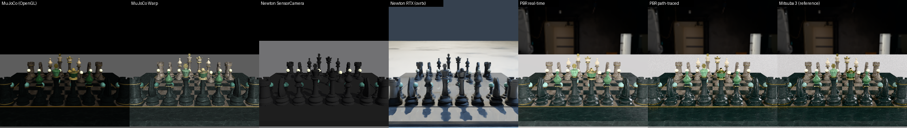

**anymal_c**

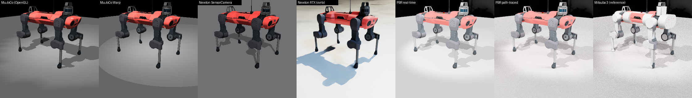

**damaged_helmet**

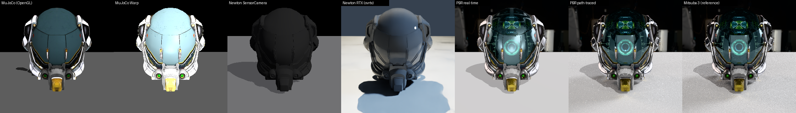

**franka_showroom**

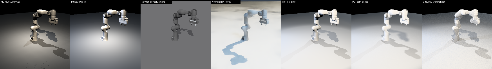

**material_grid**

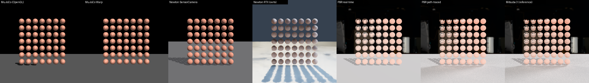

**primitives**

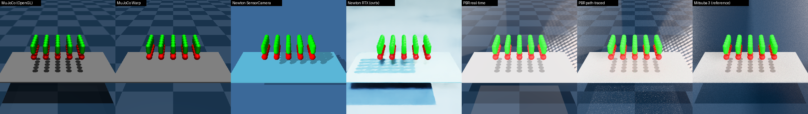

## NVIDIA H200

NVIDIA H200, 580.178.04, 143771 MiB, 9.0. Linux-6.12.105+-x86_64-with-glibc2.39. warp-lang 1.18.0, mujoco 3.17.0.dev1004626286, mujoco-warp 3.16.0, newton 1.7.0, mitsuba 3.9.1, mujoco-warp-pbr 0.0.1.

Commit `e7ce6c3a774d`.

### Single scene: 1 world, 256²

| scene | PBR real-time | PBR path (16 spp) | PBR via Newton | Newton | Newton RTX | MuJoCo Warp | MuJoCo GL | Mitsuba (16 spp) |
| --- | ---: | ---: | ---: | ---: | ---: | ---: | ---: | ---: |
| material_grid | 30.8k | 314 | 17.6k | **38.3k** | n/a | 36.6k | 65 | 24 |
| primitives | 18.6k | 158 | 11.2k | 20.7k | n/a | **29.6k** | 28 | 68 |
| damaged_helmet | 4.6k | 84 | 4.4k | 4.5k | n/a | **4.8k** | 86 | 91 |
| a_beautiful_game | 2.2k | 42 |  |  | n/a | **3.0k** | 4 | 19 |
| anymal_c | 2.3k | 47 | 1.9k | 2.8k | n/a | **3.3k** | 19 | 18 |
| franka_showroom | 1.3k | 41 | 1.5k | **1.9k** | n/a | 1.8k | 8 | 16 |
| isaac_franka_cabinet | 1.7k | 29 | 1.5k | 1.2k | n/a | **2.3k** | 22 | 20 |
| isaac_seattle_lab_table | 558 | 7 | 517 | **4.6k** | n/a | 565 | 35 | 189 |

### Batch: 4096 worlds, 64²

| scene | PBR real-time | PBR path (16 spp) | PBR via Newton | Newton | MuJoCo Warp |
| --- | ---: | ---: | ---: | ---: | ---: |
| material_grid | 908.9k | 5.1k | 704.0k | 651.3k | **1.51M** |
| primitives | 400.1k | 2.3k | 485.3k | 581.8k | **646.9k** |
| damaged_helmet | 172.2k | 1.6k | **178.9k** | 114.8k | 108.4k |
| a_beautiful_game | 125.3k | 1.2k | **128.4k** | 56.7k | 96.6k |
| anymal_c | 56.2k | 1.1k | 48.6k | **79.8k** | 58.0k |
| franka_showroom | 51.9k | 2.1k | 44.3k | **118.9k** | 51.7k |
| isaac_franka_cabinet | 136.9k | 1.3k | **143.0k** | 76.4k | 76.6k |
| isaac_seattle_lab_table | 48.5k | 415 | 49.7k | **180.4k** | 12.6k |

### Batch: 1024 worlds, 128²

| scene | PBR real-time | PBR path (16 spp) | PBR via Newton | Newton | Newton RTX | MuJoCo Warp | MuJoCo GL | Mitsuba (16 spp) |
| --- | ---: | ---: | ---: | ---: | ---: | ---: | ---: | ---: |
| material_grid | 285.4k | 1.4k | 220.8k | 251.5k | n/a | **420.6k** | 79 | 24 |
| primitives | 118.0k | 667 | 144.0k | **209.0k** | n/a | 183.8k | 32 | 85 |
| damaged_helmet | 52.4k | 450 | **54.1k** | 40.4k | n/a | 28.9k | 80 | 185 |
| a_beautiful_game | **38.2k** | 332 |  |  |  | 25.6k | 3 | 19 |
| anymal_c | 18.8k | 294 | 16.1k | **30.7k** | n/a | 17.1k | 17 | 21 |
| franka_showroom | 17.1k | 664 | 14.7k | **40.9k** | n/a | 15.0k | 8 | 19 |
| isaac_franka_cabinet | 43.4k | 349 | **46.1k** | 26.0k | n/a | 20.1k | 20 | 20 |
| isaac_seattle_lab_table | 16.4k | 127 | 17.4k | **62.2k** | n/a | 4.0k | 31 | 240 |

### Gallery

MuJoCo GL | MuJoCo Warp | Newton | Newton RTX | PBR real-time | PBR path-traced | Mitsuba (reference).

**a_beautiful_game**

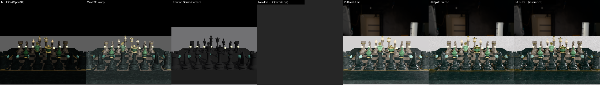

**anymal_c**

**damaged_helmet**

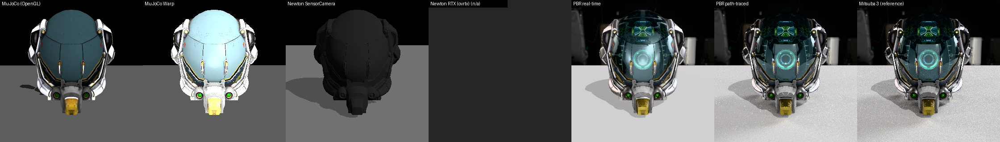

**franka_showroom**

**material_grid**

**primitives**

## NVIDIA A100-SXM4-80GB

NVIDIA A100-SXM4-80GB, 580.178.04, 81920 MiB, 8.0. Linux-6.12.103-127.188.amzn2023.x86_64-x86_64-with-glibc2.39. warp-lang 1.18.0, mujoco 3.17.0.dev1004626286, mujoco-warp 3.16.0, newton 1.7.0, mitsuba 3.9.1, mujoco-warp-pbr 0.0.1.

Commit `e7ce6c3a774d`.

### Single scene: 1 world, 256²

| scene | PBR real-time | PBR path (16 spp) | PBR via Newton | Newton | Newton RTX | MuJoCo Warp | MuJoCo GL | Mitsuba (16 spp) |
| --- | ---: | ---: | ---: | ---: | ---: | ---: | ---: | ---: |
| material_grid | 22.9k | 225 | 13.3k | 25.0k | n/a | **28.4k** | 1.6k | 17 |
| primitives | 12.1k | 123 | 8.5k | 13.5k | n/a | **21.9k** | 1.4k | 54 |
| damaged_helmet | 3.2k | 62 | 3.1k | **3.3k** | n/a | 3.0k | 2.2k | 72 |
| a_beautiful_game | 1.5k | 32 |  |  | n/a | **1.9k** | 672 | 13 |
| anymal_c | 1.8k | 40 | 1.4k | 2.1k | n/a | **2.4k** | 900 | 13 |
| franka_showroom | 842 | 30 | 1.0k | **1.5k** | n/a | 1.5k | 658 | 12 |
| isaac_franka_cabinet | 1.2k | 21 | 1.1k | 924 | n/a | **1.7k** | 1.6k | 11 |
| isaac_seattle_lab_table | 391 | 5 | 379 | **3.5k** | n/a | 426 | 1.7k | 129 |

### Batch: 4096 worlds, 64²

| scene | PBR real-time | PBR path (16 spp) | PBR via Newton | Newton | MuJoCo Warp |
| --- | ---: | ---: | ---: | ---: | ---: |
| material_grid | 551.8k | 3.6k | 431.1k | 398.5k | **900.8k** |
| primitives | 258.9k | 1.7k | 295.5k | 348.9k | **415.7k** |
| damaged_helmet | **114.1k** | 1.1k | 113.9k | 68.2k | 65.0k |
| a_beautiful_game | **79.3k** | 681 | 77.4k | 35.1k | 57.3k |
| anymal_c | 43.9k | 736 | 37.8k | **47.8k** | 35.9k |
| franka_showroom | 41.6k | 1.3k | 35.2k | **72.4k** | 34.8k |
| isaac_franka_cabinet | 83.5k | 800 | **85.7k** | 46.1k | 47.0k |
| isaac_seattle_lab_table | 27.4k | 241 | 28.3k | **109.0k** | 8.1k |

### Batch: 1024 worlds, 128²

| scene | PBR real-time | PBR path (16 spp) | PBR via Newton | Newton | Newton RTX | MuJoCo Warp | MuJoCo GL | Mitsuba (16 spp) |
| --- | ---: | ---: | ---: | ---: | ---: | ---: | ---: | ---: |
| material_grid | 170.4k | 1.0k | 132.5k | 150.5k | n/a | **257.7k** | 2.3k | 18 |
| primitives | 74.1k | 508 | 83.9k | **125.7k** | n/a | 118.6k | 1.7k | 62 |
| damaged_helmet | 35.3k | 313 | **35.3k** | 23.3k | n/a | 17.2k | 2.9k | 136 |
| a_beautiful_game | **22.1k** | 188 |  |  |  | 14.8k | 862 | 13 |
| anymal_c | 14.6k | 208 | 12.2k | **17.8k** | n/a | 10.4k | 988 | 13 |
| franka_showroom | 13.5k | 405 | 11.5k | **25.4k** | n/a | 9.5k | 739 | 12 |
| isaac_franka_cabinet | 25.4k | 224 | **26.3k** | 16.0k | n/a | 12.2k | 2.1k | 12 |
| isaac_seattle_lab_table | 9.4k | 74 | 9.7k | **37.2k** | n/a | 2.4k | 2.4k | 158 |

### Gallery

MuJoCo GL | MuJoCo Warp | Newton | Newton RTX | PBR real-time | PBR path-traced | Mitsuba (reference).

**a_beautiful_game**

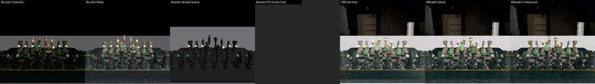

**anymal_c**

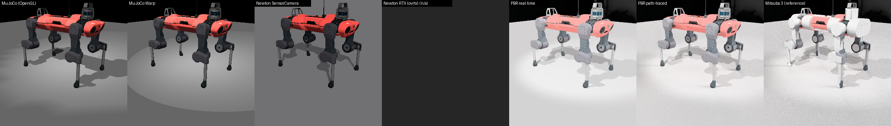

**damaged_helmet**

**franka_showroom**

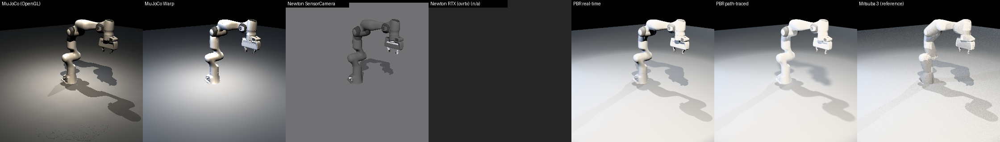

**material_grid**

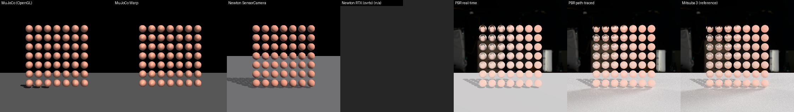

**primitives**

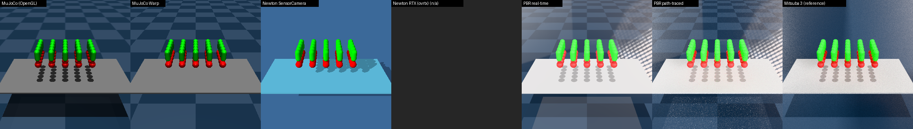

